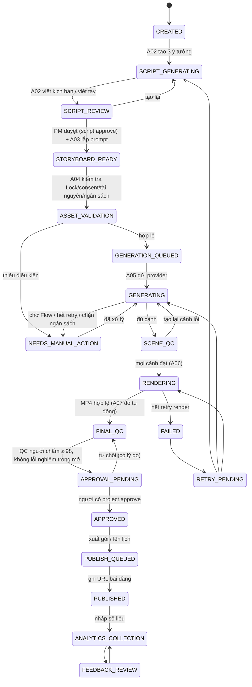

# Workflow sản xuất video



Mọi trạng thái trước PUBLISHED đều có thể → `CANCELLED` (cần quyền `project.cancel` và lý do).

| Bước | Đầu vào | Đầu ra | Phụ trách | Quyền | Retry | Chi phí |
|---|---|---|---|---|---|---|
| CREATED | Brief M02 | Project (idempotency key) | Content Creator | project.create | — | ước tính trước |
| SCRIPT_GENERATING | Brief + Brand DNA + prompt A02 | 3 ý tưởng có điểm, kịch bản | A02 | script.generate | retry dự án | LLM (thật ở PRODUCTION) |
| SCRIPT_REVIEW | Script version | Duyệt / sửa → version mới | PM | script.approve | — | — |
| STORYBOARD_READY | Scenes | Prompt 9 phần/cảnh | A03 | script.edit | dựng lại prompt | — |
| ASSET_VALIDATION | Lock, consent, asset, provider, ngân sách | Báo cáo blocking/warnings | A04 | generation.run | kiểm tra lại | kiểm tra ngân sách |
| GENERATION_QUEUED / GENERATING | Prompt + provider | Clip cảnh (asset) | A05 | generation.run | tự động 3 lần/phiên bản | cost_records VIDEO_GEN |
| SCENE_QC | Clip | QC_PASSED/QC_FAILED | A07 + QC Reviewer | qc.review | tạo lại cảnh | — |
| RENDERING | Timeline M06 | MP4 + SRT + thumbnail | A06 | render.run | tự động 2 lần, retry dự án | — |
| FINAL_QC | Render | Điểm 10 tiêu chí | A07 (gợi ý) + QC Reviewer | qc.review | chấm lại | — |
| APPROVAL_PENDING | QC PASS | Approval | PM / CEO | project.approve | — | — |
| APPROVED → PUBLISHED | Render đã duyệt | Gói xuất / bài đăng | Publisher | publish.* | — | — |
| ANALYTICS_COLLECTION | Số liệu nền tảng | Snapshots, KPI | A10 + Publisher | analytics.enter | — | — |
| FEEDBACK_REVIEW | Analytics, bình luận | Feedback cases | A08 | feedback.create | — | — |

## Feedback Loop 360°

```
INTAKE(NEW) → VALIDATE(VALIDATED, cần bằng chứng) → TRIAGE(RCA_PENDING, P0–P3 + owner + deadline + KPI)
→ ROOT CAUSE(5 Whys, FACT/HYPOTHESIS/UNKNOWN, mức chắc chắn) → CAPA(ACTION_APPROVED, ≥1 CORRECTIVE, người khác duyệt)
→ ASSIGN(IN_PROGRESS, mọi CAPA có owner+deadline, hoàn thành cần bằng chứng) → VERIFY(VERIFY_PENDING → VERIFIED | REOPENED)
→ STANDARDIZE(STANDARDIZED, ghi chú chuẩn hoá + bài học nháp) → CLOSED (bắt buộc bằng chứng + kiểm chứng đạt)
```
Bài học (M09): DRAFT → PENDING_APPROVAL → APPROVED → APPLIED (tạo prompt version mới, kích hoạt theo chế độ) → ROLLED_BACK.
